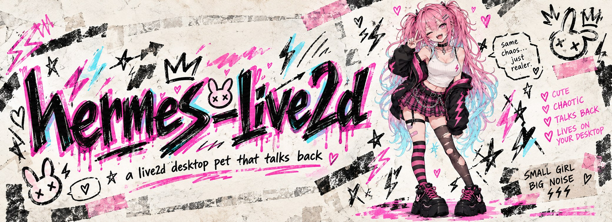

# Sparky: a desktop pet your agent can speak through

<p align="center">
  
</p>

<p align="center">
  A transparent Live2D desktop pet (Tauri 2 + pixi-live2d-display) with voice lip sync,
  expressions, mouse tracking, and a local HTTP API. Ships with the <b>Sparky</b>
  model. Point your <a href="https://github.com/NousResearch/hermes-agent">hermes agent</a> at it
  and every voice recording it generates is played on the pet — lip-synced, with a speech bubble.
</p>

<p align="center">
  <a href="https://github.com/Soundpulse/hermes-live2d/releases">Releases</a> ·
  <a href="docs/API.md">API reference</a> ·
  <a href="skills/hermes-live2d-voice/SKILL.md">Hermes skill</a> ·
  <a href="examples/claude-code-skill.md">Claude Code skill</a> ·
  <a href="AGENTS.md">Install with an agent</a>
</p>

**Useful for:**

- Health checks
- Cron reminders
- Looking cute

---

## Enable this for your hermes agent

> **Installing with an AI agent?** Point it at [`AGENTS.md`](AGENTS.md). It splits the steps
> between the agent host and your Mac and ends with a real voice test.

This is the main use case. Your hermes agent runs somewhere (e.g. an EC2 box, chatting over
the Discord gateway); the pet runs on your Mac. Whenever the agent generates a TTS recording
with its `text_to_speech` tool, a small skill uploads that audio to the pet, which plays it with
lip sync + expression + a speech bubble. Normal chat replies are **not** spoken — only recordings
the agent was already producing get routed.

```
hermes agent (remote)                         your Mac
────────────────────                          ────────
text_to_speech ──► hermes-live2d-voice skill ──► POST /speak ──► Sparky pet
                     (speak.sh, base64)          (over Tailscale)   lip sync + bubble
```

### Requirements

- **[Tailscale](https://tailscale.com)** on both the Mac and the agent host (same tailnet) — this
  is how the remote agent reaches the pet without exposing it publicly.
- **A hermes agent wired to a TTS engine** — any engine works (ElevenLabs, etc.), as long as the
  agent produces audio files via its `text_to_speech` tool. That's the audio the pet plays.
- **The `hermes-live2d-voice` skill** — bundled in this repo at
  [`skills/hermes-live2d-voice/`](skills/hermes-live2d-voice/)
  (`SKILL.md` + `speak.sh`); you install it on the agent host in step 3.

### 1. Install the desktop pet (Mac)

Requirements: **macOS on Apple Silicon** (the app uses macOS-private window APIs and builds only
for `aarch64-apple-darwin`).

Grab a build from [Releases](https://github.com/Soundpulse/hermes-live2d/releases), or build from
source:

```bash
pnpm install
pnpm tauri build          # release .app / .dmg under src-tauri/target/release/bundle/
# or, during development:
pnpm tauri dev
```

The Sparky model is bundled under `public/model/`, so no separate model download is required.
To use a different Live2D character, put its files in `~/.sparky/model/` with the entry file
renamed to `Sparky.model3.json` — the filename is what the app looks for. Note its
expressions/keyforms will differ (see the skill's model-swap note).

Launch the app. On first run it creates `~/.sparky/config.json` and starts a local HTTP API on
`http://127.0.0.1:3210`. Confirm it's up:

```bash
curl http://127.0.0.1:3210/status
# {"ok":true,"message":"Sparky Live2D API is running"}
```

### 2. Expose the pet to your agent over Tailscale

The API binds to loopback only (`127.0.0.1`) and has no auth, so it must **not** be exposed
directly. Put it on your tailnet instead. On the Mac:

```bash
tailscale serve --bg 3210
```

This publishes the pet at `https://<mac-name>.<tailnet>.ts.net`, reachable only by your own
devices.

### 3. Install the hermes skill (agent host)

Copy the bundled skill into your hermes agent's skills directory:

```bash
mkdir -p ~/.hermes/skills/creative
cp -r skills/hermes-live2d-voice ~/.hermes/skills/creative/
```

It's a standard `SKILL.md` + `speak.sh` bundle. Tell the agent where the pet lives by adding it
to the hermes env file, so it survives gateway restarts (a shell `export` does not):

```bash
echo 'SPARKY_SPEAK_URL=https://<mac-name>.<tailnet>.ts.net' >> ~/.hermes/.env
# Only if the agent host runs Tailscale in userspace mode (common on containers/VPS):
echo 'SPARKY_SPEAK_PROXY=http://127.0.0.1:1056' >> ~/.hermes/.env
```

Restart the hermes gateway afterwards; it exports these keys to the skill. `speak.sh` never reads
the env file itself.

Verify from the agent host, then play a real clip end to end:

```bash
curl -s ${SPARKY_SPEAK_PROXY:+--proxy "$SPARKY_SPEAK_PROXY"} "$SPARKY_SPEAK_URL/status"
# {"ok":true,"message":"Sparky Live2D API is running"}
bash ~/.hermes/skills/creative/hermes-live2d-voice/speak.sh /path/to/any.mp3 2 "hi!"
# Sparky should talk with heart eyes.
```

That's it. See [`skills/hermes-live2d-voice/SKILL.md`](skills/hermes-live2d-voice/SKILL.md)
for the exact contract, the expression list, and the graceful-degrade behavior when the Mac is
asleep or offline.

---

## Features

- **Transparent desktop pet** — frameless, transparent, always-on-top; draggable and resizable
- **Mouse tracking** — eyes and head follow the cursor in real time, across multiple monitors
- **Voice lip sync** — mouth animation is driven by audio volume during playback
- **Expressions & motions** — 6 named expressions plus custom motion playback
- **Speech bubbles** — typewriter-style bubbles with configurable duration, anchored to the head
- **HTTP API** — local REST API (default port 3210) for external programs to drive the pet
- **Window memory** — remembers window position and size across launches
- **System tray** — tray icon to lock/unlock and quit
- **Calm idle** — breathing and blinking with subtle sway, so the pet does not fidget

## HTTP API at a glance

Once the app is running, the API listens on `http://127.0.0.1:3210`.

```bash
# Health check
curl http://127.0.0.1:3210/status

# Make the pet speak (text + audio + expression)
curl -X POST http://127.0.0.1:3210/speak \
  -H 'Content-Type: application/json' \
  -d '{"text": "hello!", "audio_url": "file:///path/to/audio.wav", "expression": 1}'

# Switch expression (id 1–6, or semantic name)
curl -X POST http://127.0.0.1:3210/expression \
  -H 'Content-Type: application/json' \
  -d '{"name": "heart"}'

# Show a speech bubble
curl -X POST http://127.0.0.1:3210/bubble \
  -H 'Content-Type: application/json' \
  -d '{"text": "thinking...", "duration": 3000}'
```

`/speak` also accepts inline audio as base64 (`audio_data` + `audio_format`) instead of an
`audio_url` — that's how the remote hermes skill sends recordings across the network. Full
endpoint reference: [docs/API.md](docs/API.md).

### Expressions

The model exposes **6 expressions**, addressed as `expression: 1`–`6` (names `normal`, `heart`,
`blank`, `angry`, `dizzy`, and `><`; ids are 1-based). Omit `expression` for the neutral/default
face. See the mood table in
[`skills/hermes-live2d-voice/SKILL.md`](skills/hermes-live2d-voice/SKILL.md#expression-guide) for
the current mapping. Query the live id/name list any time with
`curl http://127.0.0.1:3210/expressions`.

## Configuration

Config lives at `~/.sparky/config.json`, created on first launch:

```json
{
  "api_port": 3210
}
```

- Window position/size are saved to `~/.sparky/window_state.json`.
- Uploaded `/speak` audio is written to `~/.sparky/tmp/` and overwritten on each call.
- Drop a custom Live2D model under `~/.sparky/model/` to load it instead of the bundled Sparky
  model on startup.

The bundled Sparky model is original art, rigged with [psd2live](https://github.com/tsunehimatoi/psd2live):
a 6-style eye switch (`ParamEyeStyle` 0 to 4 plus `ParamAnger`), top-anchored mouth for lip sync,
simulated hair, and chest, thigh and pendant physics, packed into a single 2048² texture.

## Other integrations

- **Claude Code** — [`examples/claude-code-skill.md`](examples/claude-code-skill.md) is a
  TTS-agnostic example skill: generate speech with your own TTS (GPT-SoVITS, Edge-TTS, …) and
  drive the pet after each reply.
- **Custom TTS voice (optional)** — any engine that produces a supported audio file can drive
  Sparky; the Hermes path supplies its own TTS audio.

## Tech stack

| Layer | Technology |
|-------|-----------|
| Desktop framework | [Tauri 2](https://v2.tauri.app) (Rust) |
| Rendering | [PixiJS 6](https://pixijs.com) + [pixi-live2d-display](https://github.com/guansss/pixi-live2d-display) |
| Live2D | Cubism 4 SDK |
| API server | [Axum](https://github.com/tokio-rs/axum) |
| TTS (optional) | [GPT-SoVITS](https://github.com/RVC-Boss/GPT-SoVITS) |

## Limitations

- **macOS only** — relies on macOS-private APIs (transparent window, click-through, etc.); no
  Windows or Linux support.
- **Apple Silicon only** — release target is `aarch64-apple-darwin`.
- **Model-bound parameters** — expression/keyform mappings are hardcoded for the bundled model;
  swapping in a different Live2D model requires code changes.
- **Volume-driven lip sync** — mouth movement maps from audio volume, not viseme-accurate phonemes.
- **Security scan** — `skills/hermes-live2d-voice` is scanned with
  [NVIDIA SkillSpector](https://github.com/NVIDIA/SkillSpector) (`skillspector scan skills/hermes-live2d-voice --no-llm`).
- **Local, unauthenticated API** — the HTTP API listens on `127.0.0.1` with no auth; only expose
  it to trusted devices (e.g. a private tailnet), never the public internet.
- **Mouse tracking via Tauri** — `cursor_position()` behavior can vary across macOS versions.

## License

Project code is released under the MIT license.

Use of the Live2D Cubism SDK and the character model assets is subject to their respective
licenses. The bundled **Sparky** model is based on **Spark (火花)** by 夜墨ww
([booth.pm/en/items/8265367](https://booth.pm/en/items/8265367)); follow its terms.
